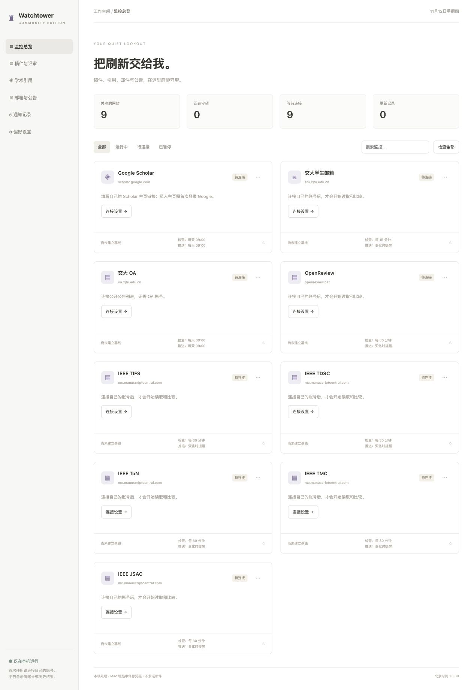

# Watchtower Community

**A quiet, local research website monitor for macOS.**

[Quick overview](FAST_README.md) · [简体中文](README.zh-CN.md) · [Privacy](docs/PRIVACY.md) · [Build](docs/BUILD.md) · [Publishing](docs/PUBLISHING.md)



Watchtower checks manuscript status, citations, campus notices and account
notifications in the background. The desktop app includes its own backend;
people using a packaged release do not need Python or Terminal.

## Nine modules, no preconfigured accounts

| Module | Read-only information | Default check cadence |
|---|---|---|
| Google Scholar | Total citations, h-index, i10-index | Daily 09:00 |
| XJTU student mail | Unread count and latest three message headers | 15 minutes |
| XJTU OA | Latest three public announcements | Daily 09:00 |
| OpenReview | Latest three account notification titles and times | 30 minutes |
| IEEE TIFS | Manuscript titles, IDs and workflow status | 30 minutes |
| IEEE TDSC | Same, via its ScholarOne entry | 30 minutes |
| IEEE ToN | Same, using the original `tnet-ieee` entry | 30 minutes |
| IEEE TMC | Same, via its ScholarOne entry | 30 minutes |
| IEEE JSAC | Same, for the official ScholarOne entry only | 30 minutes |

**All nine modules start disabled and unconnected.** Fill in your own profile
link or account inside the app and save to start. There are no sample accounts,
preloaded results, personal manuscript titles or account migrations.

Check cadence and Mac notification cadence are separate: changes only, periodic
summaries, or multiple daily times. Schedules use **Asia/Shanghai (UTC+8)**.
First successful checks establish a baseline; failures retain the last successful
snapshot and show an error instead of inventing an empty result.

## Install and connect

1. Use an Apple Silicon Mac. Download an application ZIP from this repository's
   Releases once the maintainer publishes one, or build from source below.
2. Unzip and drag **Watchtower Community.app** to Applications, then open it.
3. Select a module's connection settings. Enter your own credentials in the app;
   do not send them to an issue, a maintainer or a chat.
4. Scholar requires your own `https://scholar.google.com/citations?user=…` link.
   Private profiles require an initial Google sign-in in the app's own window.
5. Complete any verification challenge on the official site. Check the result
   before relying on scheduled monitoring. Allow Community Notifications in
   macOS notification settings if requested.

Closing the window keeps the app running in the menu bar. Quitting stops checks.
Optional “keep monitoring while locked” prevents automatic idle sleep while the
app is running; it does not prevent display sleep. Manual sleep, a closed laptop
lid, power loss or network loss can still interrupt monitoring. This is a local
app, not a remotely hosted monitoring service. No login-startup agent is installed;
add the app to macOS Login Items yourself if you want it to start after login.

## Privacy and boundaries

- New, independent app identity, website session storage and Keychain namespace.
  No importing personal-edition data or existing Edge/Safari/Chrome accounts.
- Account passwords and renewable login secrets use the local macOS Keychain.
  Configuration and snapshots remain on your Mac. The dashboard API does not
  return passwords or cookies.
- The backend binds only `127.0.0.1:18767`. No cloud account, analytics or telemetry.
- No SMTP/email delivery, Notion, activity feed or other journal modules.
- Does not read mail bodies, mark mail/notifications read, submit manuscripts,
  change submissions or bypass CAPTCHAs/MFA.
- Runtime snapshots and logs may contain **the current user's** private research
  information. Never upload the runtime folder, browser session or Keychain export.

This source and the supplied clean release contain no preconfigured user data.
That does not make a copy of your app's *runtime data* safe to publish.

## Compatibility and limitations

This release targets Apple Silicon macOS 12+ and is ad-hoc signed locally, **not
Developer ID signed or notarized**. macOS may require an explicit security review
before opening a downloaded build. No instructions disable Gatekeeper globally.
Intel/Windows/Linux desktop apps are not supplied.

Website integrations can change. A generic ScholarOne parser is provided, but
live authenticated compatibility for every listed journal is not certified.
Google may reject embedded sign-in or require account verification. OpenReview
can return gateway errors; these are shown rather than treated as successful
checks. There is no automated credential/anti-bot workaround.

JSAC uses issue-specific submission instructions. The official guidelines link
to `https://mc.manuscriptcentral.com/jsac-ieee` and also mention EDAS. **EDAS is
not supported** by this version. Verify the call for papers for your issue:
[JSAC author guidelines](https://www.comsoc.org/publications/journals/ieee-jsac/policies-guidelines).

## Build and test

Developers need an Apple Silicon Mac, Python 3.9+ and Xcode Command Line Tools.
The monitor backend itself uses only the Python standard library.

```sh
python3 -m venv .venv
.venv/bin/python -m pip install -r requirements-build.txt
PYTHONDONTWRITEBYTECODE=1 .venv/bin/python -m unittest discover -s tests -v
.venv/bin/python scripts/privacy_check.py .
.venv/bin/python native/build_desktop.py --build-dir /private/tmp/watchtower-community-build
```

The build script compiles both native helpers from source and embeds Python.
It does not need an installed copy of Watchtower, any account, or personal data.
See [BUILD.md](docs/BUILD.md) for isolated verification and ZIP creation.

## Repository layout

```text
app/                 Python engine, adapters, local API, scheduler, Keychain bridge
native/              AppKit/WebKit host and native helper source; clean app builder
web/                 Responsive dashboard and connection forms
assets/              Application icon
scripts/             Offline privacy checks and isolated verification
tests/               Synthetic fixtures and mocked tests
docs/                Setup, privacy, release checklist, clean dashboard preview
.github/workflows/   Source checks and manually triggered Apple Silicon build
```

The Actions build uploads an artifact only; it does **not** publish a release or
upload credentials. MIT licensed; see [LICENSE](LICENSE) and
[third-party notices](THIRD_PARTY_NOTICES.md). 
