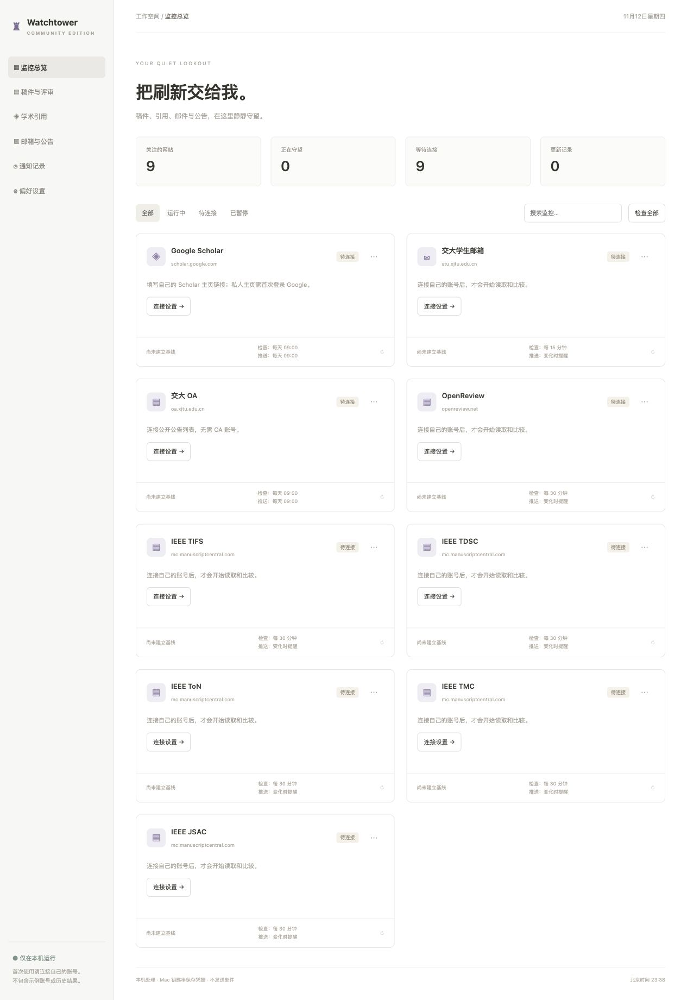

# Watchtower Community

**一个安静、清爽、仅在本机运行的 macOS 科研网站监控工具。**

[English](README.md) · [隐私说明](docs/PRIVACY.md) · [构建说明](docs/BUILD.md) · [上传 GitHub](docs/PUBLISHING.md)



独立应用内置后台服务。下载打包版本后双击使用，日常无需操作 Python 或终端。
关闭主窗口后在菜单栏继续运行，退出应用后停止检查。

## 只保留九个模块

| 模块 | 监控内容 | 默认检查频率 |
|---|---|---|
| Google Scholar | 总被引次数、h 指数、i10 指数 | 每天北京时间 09:00 |
| 交大学生邮箱 | 未读数量、最新三封邮件主题/发件人/时间 | 每 15 分钟 |
| 交大 OA | 最新三条公开公告 | 每天北京时间 09:00 |
| OpenReview | 最新三条账户通知标题和时间 | 每 30 分钟 |
| IEEE TIFS | 稿件名称、稿号、处理状态 | 每 30 分钟 |
| IEEE TDSC | 同上 | 每 30 分钟 |
| IEEE ToN | 同上，使用原 `tnet-ieee` 入口 | 每 30 分钟 |
| IEEE TMC | 同上 | 每 30 分钟 |
| IEEE JSAC | 官网 ScholarOne 入口的稿件状态 | 每 30 分钟 |

**首次运行九个模块均为“待连接”，全部关闭。** 每个人需要自行配置自己的
主页链接和账号。没有默认账号、私人引用数据、稿件记录、Cookie 或历史结果。

检查频率与 Mac 推送频率独立设置，支持变化时提醒、按间隔汇总、每天多个时间。
所有时间采用北京时间（UTC+8）。首次成功读取建立基线，后续变化再提醒；失败时
保留上次成功结果并明确标注异常。

## 开始使用

1. 使用 Apple 芯片 Mac，解压发布的应用包，把 `Watchtower Community.app`
   拖入“应用程序”。尚未发布二进制版本时，可按构建说明自行构建。
2. 打开模块的“连接设置”，填写自己的账号和密码，再保存。不要把凭据发给维护者。
3. Scholar 填写自己的 Google Scholar 主页链接。私人主页需要在应用内首次登录
   对应 Google 账号；不会继承 Edge、Safari 或 Chrome 的登录状态。
4. 如官网要求验证码、短信或二次验证，请在应用自己的连接窗口中完成。
5. 首次使用时确认真实读取结果；需要横幅提醒，请在 macOS 中允许
   Watchtower Community Notifications 通知。

“偏好设置”可开启锁屏时持续监控，防止自动闲置睡眠，允许锁屏和息屏。
手动睡眠、合盖、断电和断网仍会中断检查。这是本机工具，没有云端代查服务。
程序不会安装开机启动代理；需要登录后自动运行时，自行加入 macOS 登录项即可。

## 隐私边界

- 分享版采用独立应用身份、数据目录、网站会话和钥匙串命名，不读取个人版数据。
- 密码和登录会话存入使用者自己的 Mac 钥匙串；前端 API 不返回凭据。
- 后台仅监听 `127.0.0.1:18767`，不提供云账号、统计或遥测。
- 不包含 SMTP、邮件发送、Notion、科协活动和其他期刊模块。
- 不读取邮件正文，不改变已读状态，不提交/修改稿件，不绕过验证码与二次验证。
- 账号配置完成后，**运行数据和日志可能包含使用者自己的隐私**，不能上传到仓库。

公开源码与干净应用包不含预置个人信息；这不代表你使用后的运行数据可以公开分享。

## 兼容性说明

首版面向 Apple Silicon、macOS 12+。应用采用本地临时签名，**尚未使用开发者证书
签名或公证**，下载运行时 macOS 可能要求你确认来源；不要全局关闭系统安全保护。
没有提供 Intel、Windows 或 Linux 桌面版本。

期刊共用 ScholarOne 解析器，已做离线解析测试，但不代表逐个期刊的真实账号都已
联网验证通过。网站布局、登录流程或风控变化可能需要更新适配器。Google 可能
限制内嵌登录；OpenReview 可能出现网关错误。程序会保留旧结果并报告失败。

JSAC 官网提供 `jsac-ieee` ScholarOne 链接，也提到部分专题使用 EDAS。
**本版不支持 EDAS**，请以具体专题征稿通知为准：
[JSAC 作者指南](https://www.comsoc.org/publications/journals/ieee-jsac/policies-guidelines)。

## 开发与构建

开发需要 Apple 芯片 Mac、Python 3.9+ 与 Xcode Command Line Tools。后台仅使用
Python 标准库；PyInstaller 是打包依赖，普通使用者无需安装。

```sh
python3 -m venv .venv
.venv/bin/python -m pip install -r requirements-build.txt
PYTHONDONTWRITEBYTECODE=1 .venv/bin/python -m unittest discover -s tests -v
.venv/bin/python scripts/privacy_check.py .
.venv/bin/python native/build_desktop.py --build-dir /private/tmp/watchtower-community-build
```

构建脚本从源码编译通知和钥匙串组件，不依赖电脑上已经安装的私人应用或账号。
[构建和验收](docs/BUILD.md) · [发布清单](docs/PUBLISHING.md)。

```text
app/                 后台引擎、网站适配器、定时检查、本机接口
native/              原生窗口、独立 WebKit 会话、钥匙串和通知组件
web/                 自适应看板和连接表单
assets/              应用图标
scripts/             隐私扫描、隔离环境验收
tests/               虚构数据与模拟请求测试
docs/                隐私、构建、上传说明及干净界面预览
.github/workflows/   检查源码和手动触发的 Mac 构建
```

GitHub Actions 仅生成可下载构建产物，不自动公开发布 Release。
采用 [MIT 许可证](LICENSE)，另见 [第三方声明](THIRD_PARTY_NOTICES.md)。

